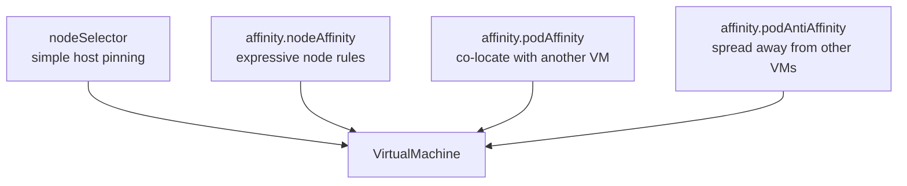

# Deploying VMs — API examples

Deploy RHEL 9, RHEL 10 and Windows Server 2025 by submitting `VirtualMachine`
objects to the API, specifying every requested knob.

> A VM **is** an API object. There is no separate "deploy" verb — you `POST` a
> `VirtualMachine` to `/apis/kubevirt.io/v1/namespaces/{ns}/virtualmachines`.

## Requirement → API field map

| Requirement | Field |
| --- | --- |
| **Subnet / IP** | `spec.template.spec.networks[]` + `...domain.devices.interfaces[]` — there is **no** IP field on a VM; see [`docs/03-networking-and-storage.md`](../docs/03-networking-and-storage.md) |
| **OS disk** | `spec.dataVolumeTemplates[]` with `sourceRef` → `DataSource` |
| **Data disk(s)** | additional `spec.dataVolumeTemplates[]` + `...spec.volumes[]` + `...domain.devices.disks[]` |
| **vCPU** | `spec.instancetype` (preferred) or `...domain.cpu.{cores,sockets,threads}` |
| **RAM** | `spec.instancetype` (preferred) or `...domain.memory.guest` |
| **OS and version** | `spec.preference` — `rhel.9`, `rhel.10`, `windows.2k25` |
| **Affinity / anti-affinity** | `...spec.nodeSelector`, `...spec.affinity.{nodeAffinity,podAffinity,podAntiAffinity}` |

## Manifests

| File | Shows |
| --- | --- |
| [`rhel9-full-example.yaml`](rhel9-full-example.yaml) | RHEL 9 with every knob annotated: subnet, OS + 2 data disks, vCPU/RAM, version, node affinity, VM anti-affinity, cloud-init |
| [`rhel10-server.yaml`](rhel10-server.yaml) | RHEL 10 via `DataSource` + instance type (4.22 ships no RHEL 10 template) |
| [`windows2025-server.yaml`](windows2025-server.yaml) | Windows Server 2025: UEFI/SecureBoot/SMM, virtio drivers, sysprep |

## Check prerequisites via the API

```bash
NS=vms
SERVER=$(oc whoami --show-server)
```

```bash
# Which boot sources exist, and are they Ready?
oc get datasources -n openshift-virtualization-os-images

# Via REST - one call, with the readiness condition
curl -s $CURL "$SERVER/apis/cdi.kubevirt.io/v1beta1/namespaces/openshift-virtualization-os-images/datasources" \
  | python3 -c "
import json,sys
for d in json.load(sys.stdin)['items']:
    c={x['type']:x for x in d.get('status',{}).get('conditions',[])}
    ready=c.get('Ready',{})
    print(f\"{d['metadata']['name']:18} {ready.get('status','?'):6} {ready.get('message','')}\")
"
```

`win2k25` reports `False / PVC not found` on a stock cluster. Populate it first —
see [`docs/01-boot-sources.md`](../docs/01-boot-sources.md).

## Deploy

### Option 1 — submit a manifest

```bash
envsubst < rhel9-full-example.yaml | oc apply -f -

# Server-side dry run first, to exercise the admission webhooks
envsubst < rhel9-full-example.yaml | oc apply --dry-run=server -f -
```

### Option 2 — REST

```bash
curl -s $CURL -X POST \
  -H 'Content-Type: application/yaml' \
  "$SERVER/apis/kubevirt.io/v1/namespaces/$NS/virtualmachines" \
  --data-binary @<(envsubst < rhel9-full-example.yaml)
```

### Option 3 — generate the manifest, then submit it

`virtctl create vm` builds a valid `VirtualMachine` without you writing YAML:

```bash
virtctl create vm \
  --name rhel9-app01 \
  --volume-import type:ds,src:openshift-virtualization-os-images/rhel9 \
  --instancetype u1.large \
  -o yaml | oc apply -f -
```

What that produces, for reference:

```yaml
apiVersion: kubevirt.io/v1
kind: VirtualMachine
metadata:
  name: rhel9-app01
spec:
  runStrategy: Always
  dataVolumeTemplates:
    - metadata: {name: imported-volume-xxxxx}
      spec:
        sourceRef:
          kind: DataSource
          name: rhel9
          namespace: openshift-virtualization-os-images
        storage: {resources: {}}
  instancetype:
    inferFromVolume: imported-volume-xxxxx
    inferFromVolumeFailurePolicy: Ignore
  preference:
    inferFromVolume: imported-volume-xxxxx
    inferFromVolumeFailurePolicy: Ignore
  template:
    spec:
      domain:
        memory: {guest: 512Mi}
        resources: {}
      volumes:
        - name: imported-volume-xxxxx
          dataVolume: {name: imported-volume-xxxxx}
```

## OS and version

`preference` selects the OS-specific device and feature tuning.

```bash
oc get virtualmachineclusterpreferences
```

```bash
curl -s $CURL "$SERVER/apis/instancetype.kubevirt.io/v1beta1/virtualmachineclusterpreferences" \
  | python3 -c "import json,sys; print('\n'.join(i['metadata']['name'] for i in json.load(sys.stdin)['items']))"
```

| Guest | Preference |
| --- | --- |
| RHEL 9 | `rhel.9` |
| RHEL 10 | `rhel.10` |
| Windows Server 2025 | `windows.2k25` |
| Windows 11 | `windows.11` (add `tpm: {enabled: true}`) |

Boot sources advertise their defaults as labels, which is how the console wizard
pre-fills the form:

```bash
curl -s $CURL "$SERVER/apis/cdi.kubevirt.io/v1beta1/namespaces/openshift-virtualization-os-images/datasources/rhel9" \
  | python3 -c "
import json,sys
l=json.load(sys.stdin)['metadata'].get('labels',{})
for k,v in sorted(l.items()):
    if 'instancetype' in k: print(f'{k} = {v}')
"
```

## vCPU and RAM

**Instance type** — the supported, reusable path:

```bash
oc get virtualmachineclusterinstancetypes
oc describe virtualmachineclusterinstancetype u1.large
```

```yaml
spec:
  instancetype:
    kind: VirtualMachineClusterInstancetype    # or VirtualMachineInstancetype
    name: u1.large
```

| Family | vCPU:RAM |
| --- | --- |
| `u1` | 1:8 general purpose |
| `o1` | overcommitted, higher density |
| `cx1` | 1:2 compute intensive |
| `m1` | 1:16 memory intensive |
| `d1` | dense, many small VMs |
| `n1` | network intensive |

The `…1gi` suffix marks hugepage-backed variants.

**Explicit** — when you need a shape no instance type covers:

```yaml
spec:
  template:
    spec:
      domain:
        cpu:
          cores: 4
          sockets: 1
          threads: 1
          maxSockets: 16       # enables CPU hot-plug up to 16 sockets (4x rule)
        memory:
          guest: 16Gi
          maxGuest: 64Gi       # enables memory hot-plug (needs virtio-mem in guest)
```

**Inferred from the boot source** — what the console wizard does:

```yaml
spec:
  instancetype:
    inferFromVolume: my-root-disk
    inferFromVolumeFailurePolicy: Ignore
```

After creation, read back what the controller resolved:

```bash
curl -s $CURL "$SERVER/apis/kubevirt.io/v1/namespaces/$NS/virtualmachines/rhel9-app01" \
  | python3 -c "
import json,sys
d=json.load(sys.stdin)['status']
print('instancetype:', d.get('instancetypeRef',{}).get('name'))
print('preference  :', d.get('preferenceRef',{}).get('name'))
"
```

## Affinity and anti-affinity



The scheduler evaluates these against the `virt-launcher` **pod** — a VM is a pod.

**Pin to a host:**

```yaml
spec:
  template:
    spec:
      nodeSelector:
        kubernetes.io/hostname: worker-01.example.com
```

```bash
oc patch vm rhel9-app01 -n $NS --type merge -p \
  '{"spec":{"template":{"spec":{"nodeSelector":{"kubernetes.io/hostname":"worker-01.example.com"}}}}}'
```

**Expressive node rules:**

```yaml
      affinity:
        nodeAffinity:
          requiredDuringSchedulingIgnoredDuringExecution:
            nodeSelectorTerms:
              - matchExpressions:
                  - {key: node-role.kubernetes.io/worker, operator: Exists}
                  - {key: topology.kubernetes.io/zone, operator: In, values: [zone-a]}
          preferredDuringSchedulingIgnoredDuringExecution:
            - weight: 100
              preference:
                matchExpressions:
                  - {key: node-type, operator: In, values: [virtualization]}
```

**VM-to-VM anti-affinity** — spread replicas across nodes:

```yaml
      affinity:
        podAntiAffinity:
          requiredDuringSchedulingIgnoredDuringExecution:
            - labelSelector:
                matchExpressions:
                  - {key: app, operator: In, values: [rhel9-app01]}
              topologyKey: kubernetes.io/hostname
```

> **Capacity warning.** `requiredDuringScheduling` anti-affinity caps you at one
> VM per matching node. On a two-worker cluster a third replica stays `Pending`
> forever. Use `preferredDuringScheduling` for soft spreading.

Inspect what the scheduler decided:

```bash
oc get vmi rhel9-app01 -n $NS -o jsonpath='{.status.nodeName}{"\n"}'
```

## Subnet / IP

There is no static-IP field on a VM. Addresses come from the pod network, a
Multus NAD's IPAM, external DHCP on the VLAN, or cloud-init.

```yaml
      networks:
        - name: podnet
          pod: {}
        - name: vlan60
          multus:
            networkName: default/vlan-60
      domain:
        devices:
          interfaces:
            - name: podnet
              masquerade: {}
            - name: vlan60
              bridge: {}
              model: virtio
```

Confirm what the guest actually received:

```bash
curl -s $CURL "$SERVER/apis/kubevirt.io/v1/namespaces/$NS/virtualmachineinstances/rhel9-app01" \
  | python3 -c "
import json,sys
for i in json.load(sys.stdin)['status'].get('interfaces',[]):
    print(i['name'], i.get('ipAddress'), i.get('mac'))
"
```

Full detail in [`docs/03-networking-and-storage.md`](../docs/03-networking-and-storage.md).

## Verify the deployment

```bash
# DataVolume import state
oc get dv -n $NS
curl -s $CURL "$SERVER/apis/cdi.kubevirt.io/v1beta1/namespaces/$NS/datavolumes" \
  | python3 -c "import json,sys; [print(i['metadata']['name'], i['status'].get('phase')) for i in json.load(sys.stdin)['items']]"

# VM state
oc get vm,vmi -n $NS

# Is it live-migratable? (needs RWX storage)
oc get vm rhel9-app01 -n $NS \
  -o jsonpath='{range .status.conditions[*]}{.type}={.status} {.message}{"\n"}{end}'
```

## Validated on OCP 4.22 / CNV 4.22.12 (luke cluster, 2026-10-17)

Deployed a VM from the `centos-stream9` boot source using the
`rhel9-full-example.yaml` pattern (`dataVolumeTemplates` + `sourceRef`,
`instancetype: u1.large`, `preference: centos.stream9`, `nodeSelector`,
preferred pod anti-affinity, masquerade pod network):

- **Boot-source clone via `sourceRef` works.** The controller created the
  DataVolume from the `DataSource`; on NFS-CSI the import ran as a smart clone
  (`SnapshotForSmartCloneInProgress` → `CloneFromSnapshotSourceInProgress`)
  and the VM reached Running in ~4 min for a 35 Gi disk.
- **Instance type resolved correctly.** `status.instancetypeRef: u1.large`,
  `status.preferenceRef: centos.stream9`; the VMI came up with 2 cores /
  8 GiB as the type specifies.
- **`nodeSelector` honored** — the VMI landed on the pinned node; the
  preferred anti-affinity was accepted (one VM, nothing to spread against).
- **Ownership:** both `dataVolumeTemplates` DVs are owned by the VM
  (`ownerReference` → VirtualMachine), so deleting the VM garbage-collects
  the DVs and their PVCs. See [`04-delete/`](../04-delete/).
- **Multus not installed** on this cluster — the `vlan60` NAD leg of the full
  example cannot be exercised without it (`networkattachmentdefinitions` CRD
  absent). The masquerade pod-network leg works and is the one that keeps the
  VM live-migratable (see [`02-lifecycle/`](../02-lifecycle/)).
- **Boot-source readiness:** on a stock cluster `rhel9`, `rhel8`, `rhel10`,
  `centos-stream9/10`, `fedora` are Ready; all Windows sources and `rhel7`
  report `PVC not found` until an administrator populates them (see
  [`docs/01-boot-sources.md`](../docs/01-boot-sources.md)).

## Clean up a failed deployment

```bash
oc delete vm rhel9-app01 -n $NS
oc delete dv -n $NS -l app=rhel9-app01
```

Watch the deletion order — see [`04-delete/`](../04-delete/).
