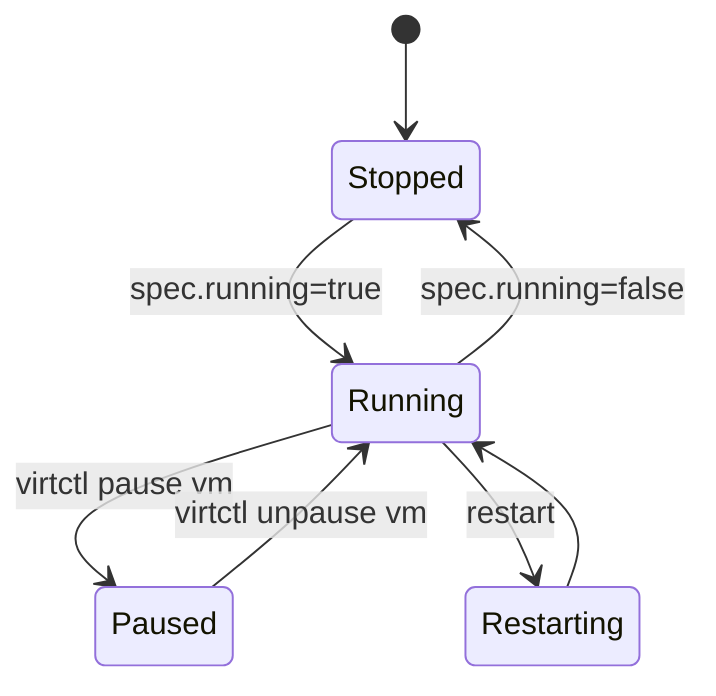
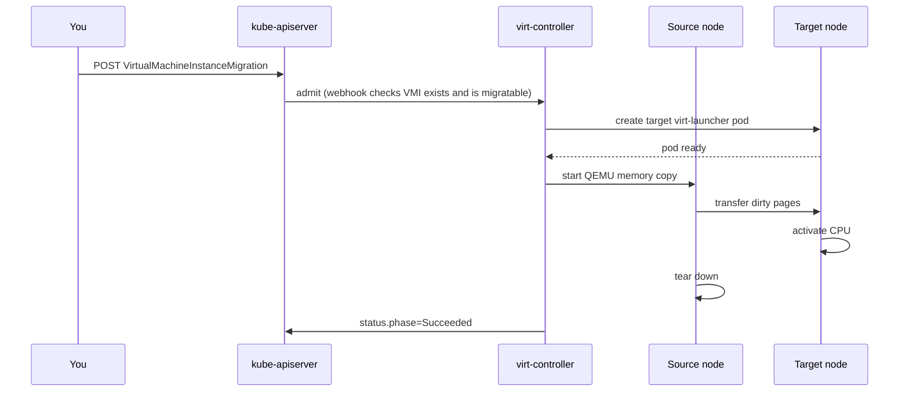

# VM lifecycle — API examples

Power operations, live migration and node maintenance, expressed as API calls.

| File | Contents |
| --- | --- |
| [`vmim.yaml`](vmim.yaml) | `VirtualMachineInstanceMigration` manifest templates |

```bash
NS=vms
VM=web-01
SERVER=$(oc whoami --show-server)
```

---

## Power operations

Every power operation mutates the **`VirtualMachine`**. Never edit the
`VirtualMachineInstance` — the VM controller will revert it.



### Start

```bash
oc patch vm $VM -n $NS --type merge -p '{"spec":{"running":true}}'
```

```bash
curl -s $CURL -X PATCH \
  -H 'Content-Type: application/merge-patch+json' \
  "$SERVER/apis/kubevirt.io/v1/namespaces/$NS/virtualmachines/$VM" \
  -d '{"spec":{"running":true}}'
```

### Stop

```bash
oc patch vm $VM -n $NS --type merge -p '{"spec":{"running":false}}'
```

Graceful stop sends an ACPI shutdown request; the guest flushes and exits.
A **forced** stop kills the QEMU process and risks guest filesystem corruption:

```bash
oc delete vmi $VM -n $NS --grace-period=0 --force
```

### Restart

```bash
oc patch vm $VM -n $NS --type merge -p '{"spec":{"running":false}}'
# wait for the VMI to disappear, then
oc patch vm $VM -n $NS --type merge -p '{"spec":{"running":true}}'
```

### Subresources — what `virtctl` actually calls

```bash
curl -s $CURL -X PUT "$SERVER/apis/subresources.kubevirt.io/v1/namespaces/$NS/virtualmachines/$VM/start"
curl -s $CURL -X PUT "$SERVER/apis/subresources.kubevirt.io/v1/namespaces/$NS/virtualmachines/$VM/stop"
curl -s $CURL -X PUT "$SERVER/apis/subresources.kubevirt.io/v1/namespaces/$NS/virtualmachines/$VM/restart"
```

### Validated on OCP 4.22 / CNV 4.22.12

The `spec.running` field is **deprecated** and rejected by admission when the VM
already has a `runStrategy` set (the common case for MTV-imported or
operator-managed VMs). The working pattern on a live cluster:

```bash
# Start
oc patch vm $VM -n $NS --type merge -p '{"spec":{"runStrategy":"Always"}}'
# Stop
oc patch vm $VM -n $NS --type merge -p '{"spec":{"runStrategy":"Halted"}}'
# Restart = stop, wait for VMI to disappear, then start
```

`spec.running` only works when `runStrategy` is `Manual`. For VMs that already
carry a `runStrategy`, the patch above is the reliable path.

> **Validated finding (2026-10-16, luke cluster).** Even with `runStrategy: Manual`,
> patching `spec.running` is rejected by admission on OCP 4.22 / KubeVirt v1:
>
> ```
> The request is invalid: spec.running: Running and RunStrategy are mutually
> exclusive. Note that Running is deprecated, please use RunStrategy instead
> ```
>
> In practice, **`spec.running` is unusable on any VM that has a `runStrategy`
> set** — including `Manual`. The only working power-operation path on 4.22 is
> the `runStrategy` patch above or the `start`/`stop`/`restart` subresources.

### runStrategy vs running

These are **mutually exclusive**. `spec.running` is ignored on a VM whose
`runStrategy` is `Always` or `Halted` — the controller just recreates the VMI.

| `runStrategy` | Behaviour |
| --- | --- |
| `Always` | VMI always running, restarts on failure |
| `Halted` | VMI never running |
| `Manual` | API-controlled — `spec.running` works |
| `RerunOnFailure` | Start, restart on failure, stop on clean exit |
| `Once` | Run once, never restart |

```bash
# Declarative "this VM should never run"
oc patch vm $VM -n $NS --type merge -p '{"spec":{"runStrategy":"Halted"}}'

# Make spec.running controllable, then start
# NOTE: on OCP 4.22 this second patch is rejected — see "Validated finding" above.
oc patch vm $VM -n $NS --type merge -p '{"spec":{"runStrategy":"Manual"}}'
oc patch vm $VM -n $NS --type merge -p '{"spec":{"running":true}}'  # rejected on 4.22

### Pause / unpause

Pausing keeps machine state in memory — it is not a stop. There is no
declarative field; use the subresource:

```bash
virtctl pause   vm $VM -n $NS
virtctl unpause vm $VM -n $NS
```

### Observe

```bash
oc get vm $VM -n $NS -o jsonpath='{.status.printableStatus}{"\n"}'

curl -s $CURL "$SERVER/apis/kubevirt.io/v1/namespaces/$NS/virtualmachines/$VM" \
  | python3 -c "
import json,sys
d=json.load(sys.stdin)
print('runStrategy:', d['spec'].get('runStrategy'))
print('running    :', d['spec'].get('running'))
print('state      :', d['status'].get('printableStatus'))
print('ready      :', d['status'].get('ready'))
"
```

---

## Live migration

Move a **running** VM to another compute server with no perceived downtime.



### Preconditions

```bash
# 1. The VM is running
oc get vmi $VM -n $NS

# 2. Storage is ReadWriteMany
oc get pvc -n $NS

# 3. Migratability conditions
oc get vm $VM -n $NS -o jsonpath='{range .status.conditions[?(@.type=="LiveMigratable")]}{.status} {.message}{"\n"}{end}'
oc get vm $VM -n $NS -o jsonpath='{range .status.conditions[?(@.type=="StorageLiveMigratable")]}{.status} {.message}{"\n"}{end}'

# 4. A second schedulable node exists
oc get nodes
```

`ReadWriteOnce` storage cannot live-migrate. Passthrough devices (GPU, SR-IOV VF)
cannot either.

> **Pod-network interface must use masquerade.** A VM whose pod-network interface
> uses `bridge: {}` is **not** live-migratable. The `LiveMigratable` condition
> reports:
>
> ```
> False: cannot migrate VMI which does not use masquerade or a migratable
> plugin to connect to the pod network
> ```
>
> Switch to `masquerade: {}` in the interface spec and restart the VMI (delete
> the VMI; the VM controller recreates it with the new interface):
>
> ```bash
> oc patch vm $VM -n $NS --type merge \
>   -p '{"spec":{"template":{"spec":{"domain":{"devices":{"interfaces":[{"name":"net-0","model":"virtio","masquerade":{}}]}}}}}}'
> oc delete vmi $VM -n $NS
> # the VM controller recreates the VMI with masquerade; LiveMigratable flips to True
> ```

### Request a migration

Scheduler chooses the target:

```bash
virtctl migrate $VM -n $NS
```

By object — this is exactly what `virtctl` creates:

```bash
oc apply -f - <<YAML
apiVersion: kubevirt.io/v1
kind: VirtualMachineInstanceMigration
metadata:
  name: ${VM}-migrate
  namespace: ${NS}
spec:
  vmiName: ${VM}
YAML
```

```bash
curl -s $CURL -X POST \
  -H 'Content-Type: application/json' \
  "$SERVER/apis/kubevirt.io/v1/namespaces/$NS/virtualmachineinstancemigrations" \
  -d "{\"apiVersion\":\"kubevirt.io/v1\",\"kind\":\"VirtualMachineInstanceMigration\",
       \"metadata\":{\"name\":\"$VM-migrate\",\"namespace\":\"$NS\"},
       \"spec\":{\"vmiName\":\"$VM\"}}"
```

Pin a specific target node:

```yaml
apiVersion: kubevirt.io/v1
kind: VirtualMachineInstanceMigration
metadata:
  name: web-01-migrate-pinned
  namespace: vms
spec:
  vmiName: web-01
  priority: user-triggered        # system-critical | user-triggered | system-maintenance
  addedNodeSelector:
    kubernetes.io/hostname: worker-02.example.com
```

> `addedNodeSelector` may only **restrict** the node set allowed by the VM's own
> `nodeSelector`/`nodeAffinity` — it can never widen it. On key collisions the
> VM's value wins, so a migration cannot bypass placement rules.

### Track it

```bash
oc get vmim -n $NS -w
oc get vmim $VM-migrate -n $NS -o jsonpath='{.status.phase}{"\n"}'
```

```bash
# Poll via REST
curl -s $CURL "$SERVER/apis/kubevirt.io/v1/namespaces/$NS/virtualmachineinstancemigrations/$VM-migrate" \
  | python3 -c "import json,sys; print(json.load(sys.stdin)['status'].get('phase'))"
```

Phases: `Pending` → `Scheduling` → `TargetReady` → `Running` → `Succeeded`
(or `Failed` / `Canceled`).

> **Validated (2026-10-16, luke cluster).** A pinned migration
> (`addedNodeSelector: kubernetes.io/hostname: control02.syangsao.net`) on a
> 2-core / 4 GiB CentOS Stream 9 VM completed in **~5 seconds** (Pending →
> Succeeded). The `migrationState` on the VMI records `mode: PreCopy`,
> `sourceNode`, `targetNode`, and `targetDirectMigrationNodePorts`. On a small
> VM with little dirty memory, the entire pre-copy cycle is nearly instant.

### Cancel

```bash
virtctl migrate-cancel $VM -n $NS
```

Cancellation is **not instant**. The target pod is torn down and the VM keeps
running on the source node.

### A VM's own view during migration

```bash
oc get vmi $VM -n $NS -o jsonpath='{.status.migrationState}{"\n"}' | python3 -m json.tool
```

```json
{
  "completed": false,
  "sourceNode": "worker-01.example.com",
  "targetNode": "worker-02.example.com",
  "targetNodeAddress": "10.0.0.12",
  "targetNodeDomainReadyTimestamp": "...",
  "migrationConfiguration": {"parallelOutboundMigrationsPerNode": 2}
}
```

### Cold migration

A stopped VM has no VMI. Change its placement and let the next start land on the
new node:

```bash
oc patch vm $VM -n $NS --type merge -p \
  '{"spec":{"template":{"spec":{"nodeSelector":{"kubernetes.io/hostname":"worker-02.example.com"}}}}}'
```

---

## Node maintenance

With `evictionStrategy: LiveMigrate` (the cluster default) a drain migrates the
node's VMs automatically. VMs that cannot migrate block the drain.

```bash
oc adm cordon worker-01.example.com
oc adm drain  worker-01.example.com --ignore-daemonsets --delete-emptydir-data
# ... maintenance ...
oc adm uncordon worker-01.example.com
```

Stop VMs rather than migrate them by setting the strategy on the VM:

```bash
oc patch vm $VM -n $NS --type merge -p \
  '{"spec":{"template":{"spec":{"evictionStrategy":"None"}}}}'
```

| `evictionStrategy` | On node drain |
| --- | --- |
| `LiveMigrate` | VM is live-migrated away |
| `None` | VM is powered off |

### Inventory VMs per node

```bash
oc get vmi -A -o custom-columns=\
NAMESPACE:.metadata.namespace,VM:.metadata.name,NODE:.status.nodeName,PHASE:.status.phase
```

```bash
curl -s $CURL "$SERVER/apis/kubevirt.io/v1/virtualmachineinstances" \
  | python3 -c "
import json,sys
from collections import Counter
items=json.load(sys.stdin)['items']
c=Counter(i['status'].get('nodeName','<unscheduled>') for i in items)
for node,n in c.most_common(): print(f'{node:35} {n} VM(s)')
"
```

### Find non-migratable VMs before draining

```bash
for vmi in $(oc get vmi -A -o jsonpath='{range .items[*]}{.metadata.namespace}/{.metadata.name}{"\n"}{end}'); do
  ns=${vmi%%/*}; name=${vmi##*/}
  lm=$(oc get vm "$name" -n "$ns" -o jsonpath='{.status.conditions[?(@.type=="LiveMigratable")].status}')
  [ "$lm" != "True" ] && echo "$ns/$name LiveMigratable=$lm"
done
```
