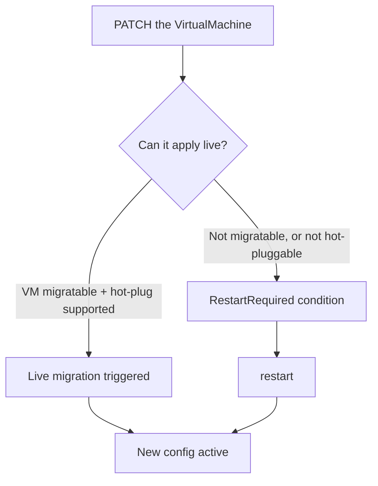

# Increasing and decreasing VM components — API examples

Resize vCPU, RAM, disks and NICs. Hot-plugged where the platform supports it,
otherwise by patching the VM and restarting.

```bash
NS=vms
VM=web-01
SERVER=$(oc whoami --show-server)
```

## What can change without a restart

| Component | Hot-plug? | Ceiling | Guest requirement |
| --- | --- | --- | --- |
| **vCPU** (`cores`) | ❌ on 4.22 | — | restart required |
| **RAM** (`guest`) | ✅ | up to **4×** the boot value | `virtio-mem` driver |
| **Disk** | ⚠️ addvolume rejected on 4.22 | — | JSON patch + restart |
| **NIC** | ❌ | — | restart required |
| **Instance type** | ❌ | — | restart required |

The 4× ceiling comes from `maxSockets` / `maxGuest`. Set them **before** the guest
boots; raising them later requires a restart.

```yaml
      domain:
        cpu:
          sockets: 2
          maxSockets: 8        # hot-plug up to 8 sockets (4x)
        memory:
          guest: 4Gi
          maxGuest: 16Gi       # hot-plug up to 16Gi (4x)
```

## How a resize is applied



Check which path you landed on:

```bash
oc get vm $VM -n $NS \
  -o jsonpath='{range .status.conditions[?(@.type=="RestartRequired")]}{.status} {.message}{"\n"}{end}'
```

---

## vCPU

`maxSockets` is the ceiling, not the current count.

```bash
oc patch vm $VM -n $NS --type merge -p \
  '{"spec":{"template":{"spec":{"domain":{"cpu":{"sockets":4,"maxSockets":16}}}}}'
```

```bash
curl -s $CURL -X PATCH \
  -H 'Content-Type: application/merge-patch+json' \
  "$SERVER/apis/kubevirt.io/v1/namespaces/$NS/virtualmachines/$VM" \
  -d '{"spec":{"template":{"spec":{"domain":{"cpu":{"sockets":4,"maxSockets":16}}}}}}'
```

Decrease by patching a smaller value. CPU hot-**un**plug is not supported by every
guest; if the count does not drop, restart.

> **Validated finding (2026-10-16, luke cluster, CentOS Stream 9).** Changing
> `cpu.cores` on a running VM does **not** hot-plug on OCP 4.22 / KubeVirt v1.
> The patch is accepted, the VMI keeps its original core count, and a
> `RestartRequired` condition is raised:
>
> ```
> RestartRequired: True — a non-live-updatable field was changed in the template spec
> ```
>
> No live migration is triggered. A manual restart (stop → start) applies the
> change. This differs from the documentation claim that vCPU hot-plug works up
> to 4× the boot value; on this cluster configuration it requires a restart.

> **Network queue caveat.** With `networkInterfaceMultiQueue` enabled, interfaces
> that existed before a CPU hot-plug keep their original queue count. Only a
> restart refreshes them. Interfaces hot-plugged *after* the CPU change pick up
> the new count automatically.

---

## RAM

```bash
oc patch vm $VM -n $NS --type merge -p \
  '{"spec":{"template":{"spec":{"domain":{"memory":{"guest":"16Gi","maxGuest":"64Gi"}}}}}}'
```

```bash
curl -s $CURL -X PATCH \
  -H 'Content-Type: application/merge-patch+json' \
  "$SERVER/apis/kubevirt.io/v1/namespaces/$NS/virtualmachines/$VM" \
  -d '{"spec":{"template":{"spec":{"domain":{"memory":{"guest":"16Gi"}}}}}}'
```

Guest support for `virtio-mem`:

| Guest | Requirement |
| --- | --- |
| RHEL 9.4+ | ✅ |
| RHEL 8.10+ | ✅ (hot-**un**plug disabled by default) |
| Other Linux | kernel ≥ 5.16 with the `virtio-mem` module |
| Windows | virtio-win ≥ `100.95.104.26200` |

> **Windows caveat (validated on OCP 4.22).** vCPU and RAM hot-plug changes are
> accepted by the API but do **not** take effect on a running Windows VMI without
> a restart. The patch updates the VM spec, the VMI keeps its original values,
> and a `RestartRequired` condition is raised. RHEL 9 applies both live. This is
> a guest-OS driver limitation (virtio-mem / CPU hotplug in the Windows image),
> not a KubeVirt one.

Memory hot-**un**plug is more restricted than hot-plug — decreasing often needs a
restart even when increasing does not.

> **Validated (2026-10-16, luke cluster, CentOS Stream 9).** RAM hot-plug
> **works**: patching `memory.guest` from 2 Gi → 4 Gi on a running VM updated
> the VMI within one poll cycle (~5 s) with no restart and no
> `RestartRequired` condition. The guest must have the `virtio-mem` driver
> loaded (CentOS Stream 9 ships it by default).

---

## Disks

### Hot-plug via the `addvolume` subresource

This is what `virtctl addvolume` calls. The body is `v1.AddVolumeOptions`:

| Field | Required | Meaning |
| --- | --- | --- |
| `name` | ✅ | disk + volume name; **overrides** `disk.name` |
| `disk` | ✅ | `v1.Disk` — set the bus, e.g. `{"bus":"virtio"}` or `{"bus":"scsi"}` |
| `volumeSource` | ✅ | `{"dataVolume":{"name":"..."}}` or `{"persistentVolumeClaim":{"claimName":"..."}}` |
| `dryRun` | — | `"All"` to validate without persisting |

```bash
oc get vmi $VM -n $NS -o jsonpath='{.status.phase}{"\n"}'   # must be Running

curl -s $CURL -X PUT \
  -H 'Content-Type: application/json' \
  "$SERVER/apis/subresources.kubevirt.io/v1/namespaces/$NS/virtualmachineinstances/$VM/addvolume" \
  -d '{
        "name": "data1",
        "disk": {"bus": "virtio"},
        "volumeSource": {"dataVolume": {"name": "web-01-data01"}}
      }'
```

Validate first:

```bash
curl -s $CURL -X PUT \
  -H 'Content-Type: application/json' \
  "$SERVER/apis/subresources.kubevirt.io/v1/namespaces/$NS/virtualmachineinstances/$VM/addvolume?dryRun=All" \
  -d '{"name":"data1","disk":{"bus":"virtio"},"volumeSource":{"dataVolume":{"name":"web-01-data01"}}}'
```

> **Validated finding (2026-10-16, luke cluster).** The `addvolume` subresource
> is **rejected** on OCP 4.22 / KubeVirt v1 even with the `HotplugVolumes`
> feature gate enabled. Every variant tried — `{"bus":"virtio"}`,
> `{"bus":"sata"}`, with and without `diskDevice: {"type":"disk"}` — returns:
>
> ```
> HTTP 422: admission webhook "virtualmachineinstances-update-validator.kubevirt.io"
> denied the request: Hotplug configuration for [data1] requires diskDevice of
> type 'disk' or 'lun' to be used.
> ```
>
> The `v1.Disk` schema in the OpenAPI spec does not expose a `diskDevice` field,
> so there is no way to satisfy the webhook. The same applies to `removevolume`:
>
> ```
> HTTP 409: Unable to remove volume [data1] because it is not hotpluggable
> ```
>
> **Working alternative:** add the volume to the VM template via JSON patch and
> restart. The disk appears on the VMI after the restart (auto-generated with
> `bus: sata` if no explicit disk entry is provided):
>
> ```bash
> oc patch vm $VM -n $NS --type json -p '[
>   {"op":"add","path":"/spec/template/spec/volumes/-",
>    "value":{"name":"data1","persistentVolumeClaim":{"claimName":"testvm-data1"}}}
> ]'
> # restart the VM to apply
> ```
### Hot-unplug

Body is `v1.RemoveVolumeOptions`, which requires only `name`:

```bash
curl -s $CURL -X PUT \
  -H 'Content-Type: application/json' \
  "$SERVER/apis/subresources.kubevirt.io/v1/namespaces/$NS/virtualmachineinstances/$VM/removevolume" \
  -d '{"name":"data1"}'
```

### Make it survive a restart

`addvolume` is **ephemeral** — the disk disappears when the VM restarts. There is
no `--persist` on the subresource; persistence is achieved by patching the VM
spec, which `virtctl addvolume --persist` does for you:

```bash
curl -s $CURL -X PATCH \
  -H 'Content-Type: application/json-patch+json' \
  "$SERVER/apis/kubevirt.io/v1/namespaces/$NS/virtualmachines/$VM" \
  -d '[
        {"op":"add","path":"/spec/template/spec/volumes/-",
         "value":{"name":"data1","dataVolume":{"name":"web-01-data01"}}},
        {"op":"add","path":"/spec/template/spec/domain/devices/disks/-",
         "value":{"name":"data1","disk":{"bus":"virtio"}}}
      ]'
```

Use **JSON patch** here, not merge patch — `volumes` and `disks` are lists, and a
merge patch would replace the whole list and detach your OS disk.

> **Merge-patch pitfall (validated on OCP 4.22).** A `--type merge` patch on
> `spec.template.spec.volumes` or `.disks` **replaces the entire array** rather
> than appending. If you omit the existing OS disk from the patch, it is
> dropped and the VM will not boot. Use a **JSON patch** with `op:add` and
> `path:/.../-` to append (as shown above), or use the `addvolume` subresource
> for live hot-plug.


### Create the disk first

```bash
oc apply -f - <<'YAML'
apiVersion: cdi.kubevirt.io/v1beta1
kind: DataVolume
metadata:
  name: web-01-data01
  namespace: vms
spec:
  source:
    blank: {}
  pvc:
    accessModes: [ReadWriteMany]
    resources:
      requests:
        storage: 100Gi
    storageClassName: nfs-csi
    volumeMode: Block
YAML

oc wait --for=jsonpath='{.status.phase}'=Succeeded dv/web-01-data01 -n $NS --timeout=15m
```

### Expand a disk

The storage class must set `allowVolumeExpansion: true`.

```bash
oc patch pvc web-01-data01 -n $NS --type merge \
  -p '{"spec":{"resources":{"requests":{"storage":"200Gi"}}}}'
```

```bash
oc get storageclass nfs-csi -o jsonpath='{.allowVolumeExpansion}{"\n"}'
```

The block device grows; the **filesystem does not**. Resize in the guest:

```bash
virtctl console $VM -n $NS
# growpart /dev/vda 2 && xfs_growfs /          # XFS
# growpart /dev/vda 2 && resize2fs /dev/vda2   # ext4
```

File systems **cannot be shrunk**. To reduce a disk, create a smaller one and
copy the data across.

### Shrink — the supported approach

```bash
# 1. create the smaller target
oc apply -f - <<'YAML'
apiVersion: cdi.kubevirt.io/v1beta1
kind: DataVolume
metadata: {name: web-01-data01-small, namespace: vms}
spec:
  source: {blank: {}}
  pvc:
    accessModes: [ReadWriteMany]
    resources: {requests: {storage: 50Gi}}
    storageClassName: nfs-csi
YAML

# 2. attach both to a maintenance VM and copy inside the guest
#    rsync -aHAX --info=progress2 /mnt/old/ /mnt/new/
# 3. swap the volume in the VM spec, restart, delete the old PVC
```

---

## NICs

There is **no hot-plug for network interfaces** in OCP 4.22. Patch the spec and
restart.

> **Pod-network limitation (validated on OCP 4.22).** A VM can have at most
> **one** interface connected to the pod network (`pod: {}`). Admission rejects
> a second one with `more than one interface is connected to a pod network`.
> Masquerade also requires the pod network, so it cannot be used as a workaround.
> A real second NIC needs **Multus** and a `NetworkAttachmentDefinition` (NAD),
> as shown in the attach example below.
>
> **Validated (2026-10-16, luke cluster).** Both rejection paths confirmed:
>
> ```bash
> # Second pod-network interface → rejected
> The request is invalid: spec.template.spec.interfaces: more than one interface
> is connected to a pod network in spec.template.spec.interfaces
>
> # Multus + masquerade (no NAD) → rejected for a different reason
> The request is invalid: spec.template.spec.domain.devices.interfaces[1].name:
> Masquerade interface only implemented with pod network
> ```
>
> A second NIC requires a real `NetworkAttachmentDefinition` and a `bridge` or
> `sr-iov` interface type (not masquerade).

### Attach

`networks[]` and `interfaces[]` must stay in sync — same `name`, one entry each.

```bash
curl -s $CURL -X PATCH \
  -H 'Content-Type: application/json-patch+json' \
  "$SERVER/apis/kubevirt.io/v1/namespaces/$NS/virtualmachines/$VM" \
  -d '[
        {"op":"add","path":"/spec/template/spec/networks/-",
         "value":{"name":"vlan60","multus":{"networkName":"default/vlan-60"}}},
        {"op":"add","path":"/spec/template/spec/domain/devices/interfaces/-",
         "value":{"name":"vlan60","model":"virtio","bridge":{}}}
      ]'
```

### Detach

Removing from the middle of a list shifts later indices, so capture the indices
first:

```bash
curl -s $CURL "$SERVER/apis/kubevirt.io/v1/namespaces/$NS/virtualmachines/$VM" \
  | python3 -c "
import json,sys
d=json.load(sys.stdin)
spec=d['spec']['template']['spec']
print('networks  :', [n['name'] for n in spec.get('networks',[])])
print('interfaces:', [i['name'] for i in spec['domain']['devices'].get('interfaces',[])])
"
```

Then remove the **higher** index first:

```bash
curl -s $CURL -X PATCH \
  -H 'Content-Type: application/json-patch+json' \
  "$SERVER/apis/kubevirt.io/v1/namespaces/$NS/virtualmachines/$VM" \
  -d '[
        {"op":"remove","path":"/spec/template/spec/domain/devices/interfaces/1"},
        {"op":"remove","path":"/spec/template/spec/networks/1"}
      ]'
```

### Apply

```bash
curl -s $CURL -X PUT \
  "$SERVER/apis/subresources.kubevirt.io/v1/namespaces/$NS/virtualmachines/$VM/restart"
```

---

## Instance type

Changing `spec.instancetype` rewrites the resolved vCPU/RAM, so it always needs a
restart. The webhook validates that the new shape is compatible with the VM's
disks and preference.

```bash
oc get virtualmachineclusterinstancetypes
```

```bash
curl -s $CURL -X PATCH \
  -H 'Content-Type: application/merge-patch+json' \
  "$SERVER/apis/kubevirt.io/v1/namespaces/$NS/virtualmachines/$VM" \
  -d '{
        "spec": {
          "instancetype": {"kind":"VirtualMachineClusterInstancetype","name":"u1.2xlarge"},
          "preference":   {"kind":"VirtualMachineClusterPreference","name":"rhel.9"}
        }
      }'
```

Validate the swap without persisting:

```bash
curl -s $CURL -X PATCH \
  -H 'Content-Type: application/merge-patch+json' \
  "$SERVER/apis/kubevirt.io/v1/namespaces/$NS/virtualmachines/$VM?dryRun=All" \
  -d '{"spec":{"instancetype":{"kind":"VirtualMachineClusterInstancetype","name":"u1.2xlarge"}}}'
```

Read back what the controller resolved:

```bash
curl -s $CURL "$SERVER/apis/kubevirt.io/v1/namespaces/$NS/virtualmachines/$VM" \
  | python3 -c "
import json,sys
s=json.load(sys.stdin)['status']
print('instancetypeRef:', s.get('instancetypeRef',{}).get('name'))
print('preferenceRef  :', s.get('preferenceRef',{}).get('name'))
"
```

---

## Verify a resize actually landed

```bash
# What the VM asks for, vs what the running VMI has
diff <(oc get vm  $VM -n $NS -o jsonpath='{.spec.template.spec.domain}' | python3 -m json.tool) \
     <(oc get vmi $VM -n $NS -o jsonpath='{.spec.domain}'            | python3 -m json.tool)
```

```bash
# Addresses the guest reported
curl -s $CURL "$SERVER/apis/kubevirt.io/v1/namespaces/$NS/virtualmachineinstances/$VM" \
  | python3 -c "
import json,sys
d=json.load(sys.stdin)['status']
for i in d.get('interfaces',[]): print('iface', i['name'], i.get('ipAddress'))
for v in d.get('volumeStatus',[]): print('vol  ', v['name'], v.get('target'))
"
```

From inside the guest:

```bash
virtctl console $VM -n $NS
# nproc ; free -h ; lsblk ; ip -br a
```

If `spec` and the guest disagree, a restart is pending.
