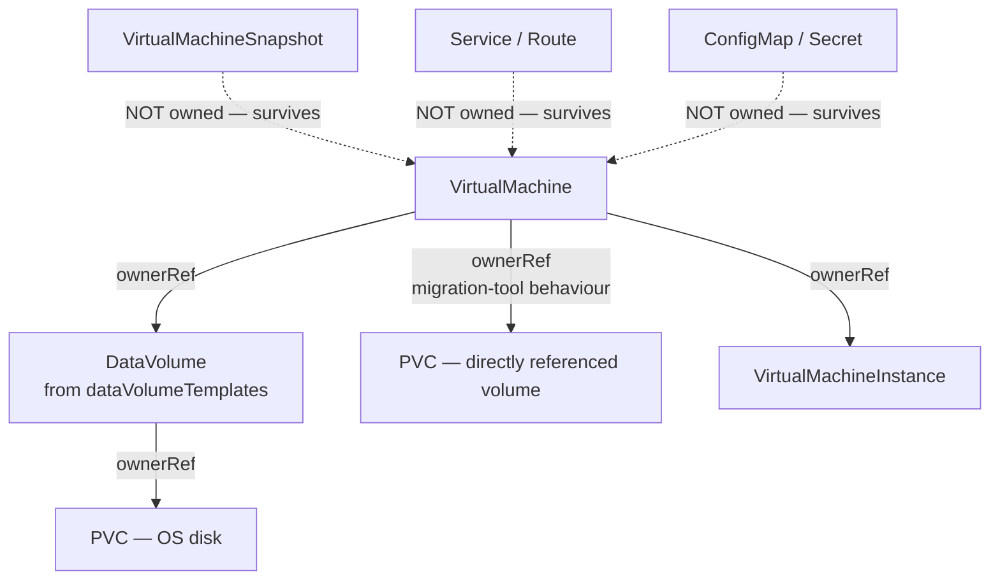

# Deleting a VM and its ancillary components — API examples

Deleting a VM is one `DELETE`. Knowing what else that `DELETE` destroys is the
part that matters — Kubernetes garbage collection follows `ownerReference`
chains, and whether your disk survives depends entirely on who owns it.

```bash
NS=vms
VM=web-01
SERVER=$(oc whoami --show-server)
```

## The danger

```bash
oc delete vm web-01 -n vms
# virtualmachine.kubevirt.io "web-01" deleted
```

If that VM's PVC has an `ownerReference` back to the `VirtualMachine`, the disk is
garbage-collected too. **The data is gone.** No undo, no recycle bin.

This is not hypothetical — clusters built by migration tooling (MTV / Forklift)
commonly attach the VM as owner of its PVC:

```bash
oc get pvc <VM_NAME>-root -n <NAMESPACE> \
  -o jsonpath='{.metadata.ownerReferences}{"\n"}'
# [{"apiVersion":"kubevirt.io/v1","blockOwnerDeletion":true,
#   "kind":"VirtualMachine","name":"<VM_NAME>","uid":"..."}]
```

## Ownership graph



| Object | Deleted with the VM? | Why |
| --- | --- | --- |
| `VirtualMachine` | ✅ | the target |
| `VirtualMachineInstance` | ✅ | owned by the VM |
| `DataVolume` from `dataVolumeTemplates` | ✅ | ownerRef → VM |
| `PVC` created by that DataVolume | ✅ | ownerRef → DataVolume |
| `PVC` referenced directly in `volumes[]` | ⚠️ **depends** | often owned after a migration |
| `VirtualMachineSnapshot` / `…Content` | ❌ | independent lifecycle |
| `VirtualMachineExport` | ❌ | TTL, else manual |
| `Service`, `Route`, `NetworkAttachmentDefinition` | ❌ | manual cleanup |
| `ConfigMap`, `Secret` | ❌ | manual cleanup |

## Step 1 — inspect before you delete

```bash
# Everything the VM owns
oc get vm $VM -n $NS -o json | python3 -c "
import json,sys,subprocess
d=json.load(sys.stdin)
ns=d['metadata']['namespace']; vm=d['metadata']['name']
spec=d['spec'].get('template',{}).get('spec',{})
refs=set()
for v in spec.get('volumes',[]):
    if 'persistentVolumeClaim' in v: refs.add(v['persistentVolumeClaim']['name'])
    if 'dataVolume' in v:
        refs.add(v['dataVolume']['name'])
for dv in d['spec'].get('dataVolumeTemplates',[]):
    refs.add(dv['metadata']['name'])

print(f'--- volumes referenced by {vm}')
for r in sorted(refs):
    for kind in ('pvc','dv'):
        o=subprocess.run(['oc','get',kind,r,'-n',ns,'-o',
                          'jsonpath={.metadata.ownerReferences[*].kind}/{.metadata.ownerReferences[*].name}'],
                         capture_output=True,text=True)
        if o.returncode==0:
            own=o.stdout.strip() or '<unowned>'
            flag='DESTROYED' if vm in own else 'survives '
            print(f'  {kind}/{r:38} owner={own:35} {flag}')
            break
"
```

```bash
# Anyone else using the disk?
oc get pvc $VM-root -n $NS -o json \
  | python3 -c "
import json,sys
d=json.load(sys.stdin)
print('accessModes:', d['spec'].get('accessModes'))
print('mounted by pods:')
" 
oc get pods -A -o json | python3 -c "
import json,sys
d=json.load(sys.stdin)
for p in d['items']:
    for v in p['spec'].get('volumes',[]):
        if v.get('persistentVolumeClaim',{}).get('claimName')=='$VM-root':
            print(' ', p['metadata']['namespace'], p['metadata']['name'], p['status'].get('phase'))
"
```

## Step 2 — delete protection

Per-VM, off by default. Inspect and toggle via annotation:

```bash
oc get vm $VM -n $NS -o jsonpath='{.metadata.annotations.kubevirt\.io/delete-protection}{"\n"}'

oc patch vm $VM -n $NS --type merge \
  -p '{"metadata":{"annotations":{"kubevirt.io/delete-protection":"true"}}}'

oc patch vm $VM -n $NS --type merge \
  -p '{"metadata":{"annotations":{"kubevirt.io/delete-protection":"false"}}}'
```

```bash
curl -s $CURL -X PATCH \
  -H 'Content-Type: application/merge-patch+json' \
  "$SERVER/apis/kubevirt.io/v1/namespaces/$NS/virtualmachines/$VM" \
  -d '{"metadata":{"annotations":{"kubevirt.io/delete-protection":"true"}}}'
```

An administrator can remove the option cluster-wide through the `HyperConverged`
CR (`spec.virtualization.virtualMachineOptions.disableDeleteProtection`). VMs
that already have it set keep their protection.

> **Validated finding (2026-10-16, luke cluster).** The delete-protection
> annotation is **not enforced** on OCP 4.22 / CNV 4.22.12. Setting
> `kubevirt.io/delete-protection: "true"` and then running
> `oc delete vm <name>` succeeds — the VM is deleted despite the annotation.
> The annotation is accepted by the API but no admission webhook or controller
> appears to act on it. **Do not rely on this annotation as a safety mechanism.**
> Use RBAC (restrict `delete` on `virtualmachines`) or a snapshot-first workflow
> instead.

## Step 3 — stop the VM

A running VM has a VMI; deleting the VM while running is allowed but the shutdown
is abrupt.

```bash
oc patch vm $VM -n $NS --type merge -p '{"spec":{"running":false}}'
oc wait --for=jsonpath='{.status.printableStatus}'=Stopped vm/$VM -n $NS --timeout=10m

# or the subresource
curl -s $CURL -X PUT "$SERVER/apis/subresources.kubevirt.io/v1/namespaces/$NS/virtualmachines/$VM/stop"
```

## Step 4 — snapshot first (optional but cheap)

See [`snapshot-before-delete.yaml`](snapshot-before-delete.yaml).

```bash
oc apply -f - <<YAML
apiVersion: snapshot.kubevirt.io/v1beta1
kind: VirtualMachineSnapshot
metadata:
  name: ${VM}-predelete
  namespace: ${NS}
spec:
  source:
    apiGroup: kubevirt.io
    kind: VirtualMachine
    name: ${VM}
YAML

oc wait --for=jsonpath='{.status.phase}'=Succeeded vmsnapshot/${VM}-predelete -n $NS --timeout=30m
```

The snapshot survives the VM deletion and can recreate both the VM and its disks.

> **Validated (2026-10-16, luke cluster).** A `VirtualMachineSnapshot` of a
> halted VM with two PVC-backed volumes completed in ~3 minutes
> (`Succeeded`, `ReadyToUse: true`). After deleting the VM, the snapshot
> survived. A `VirtualMachineRestore` recreated the VM and **new** PVCs
> (named `restore-<uid>-root`, `restore-<uid>-data1`) — the original PVCs were
> untouched. The restored VM's `volumes[]` point at the new `restore-*` PVCs,
> not the originals. The restore took ~5 minutes (PVC provisioning + data copy).
>
> **Note:** the `oc wait` shorthand for restores is
> `virtualmachinerestore/<name>` (not `vmsrestore`, which is not a registered
> short name on this cluster).

## Step 5 — preserve disks you want to keep

Clone the owned PVC to a copy with **no** `ownerReference`. An unowned object
cannot be garbage-collected by any VM deletion.

```bash
oc apply -f - <<YAML
apiVersion: cdi.kubevirt.io/v1beta1
kind: DataVolume
metadata:
  name: ${VM}-root-ARCHIVE
  namespace: ${NS}
spec:
  source:
    pvc:
      name: ${VM}-root
      namespace: ${NS}
  pvc:
    accessModes: [ReadWriteMany]
    resources:
      requests:
        storage: 30Gi
    storageClassName: nfs-csi
YAML

oc wait --for=jsonpath='{.status.phase}'=Succeeded dv/${VM}-root-ARCHIVE -n $NS --timeout=60m
```

Verify the clone is unowned:

```bash
oc get pvc ${VM}-root-ARCHIVE -n $NS -o jsonpath='{.metadata.ownerReferences}{"\n"}'
# (empty)
```

## Step 6 — delete

```bash
curl -s $CURL -X DELETE \
  "$SERVER/apis/kubevirt.io/v1/namespaces/$NS/virtualmachines/$VM"
```

### Propagation policy — the most important flag

| Policy | Effect on DataVolumes / PVCs |
| --- | --- |
| `Background` (default) | Delete the VM now, dependents afterwards |
| `Foreground` | Delete dependents first, then the VM |
| **`Orphan`** | **Leave dependents alive** |

```bash
# Keep the disks, delete only the VM object
curl -s $CURL -X DELETE \
  "$SERVER/apis/kubevirt.io/v1/namespaces/$NS/virtualmachines/$VM?propagationPolicy=Orphan"
```

```bash
oc delete vm $VM -n $NS --cascade=orphan
```

`--cascade=orphan` deletes the `VirtualMachine` and leaves the `DataVolume` and
`PVC` behind. This is the single safest way to remove a VM without losing data.

> **Validated (2026-10-16, luke cluster).** Both propagation paths tested on a
> VM with two directly-referenced PVCs (no `dataVolumeTemplates`):
>
> - **`Orphan`** (`?propagationPolicy=Orphan`): VM deleted, both PVCs and DVs
>   survived. The snapshot also survived.
> - **`Background`** (default, `--cascade=background`): VM deleted, both PVCs
>   survived — because the PVCs had **no** `ownerReference` back to the VM.
>
> The critical variable is **ownership**, not the propagation policy. If the PVC
> has an `ownerReference` to the VM (as MTV/Forklift-imported disks do), a
> Background delete garbage-collects the PVC. If the PVC is unowned, both
> Orphan and Background leave it alive. Check ownership before deleting:
>
> ```bash
> oc get pvc <pvc-name> -n $NS -o jsonpath='{.metadata.ownerReferences}{"\n"}'
> # empty → safe; non-empty with kind=VirtualMachine → will be GC'd on Background delete
> ```

### Cascading delete of the disks

```bash
oc delete vm $VM -n $NS                       # Background, the default
oc delete vm $VM -n $NS --cascade=foreground  # dependents first
```

## Step 7 — clean up what is left

Deleting the VM does **not** remove Services, ConfigMaps, snapshots or exports.

```bash
curl -s $CURL "$SERVER/api/v1/namespaces/$NS/services?labelSelector=app%3D$VM" \
  | python3 -c "import json,sys; [print(i['metadata']['name']) for i in json.load(sys.stdin)['items']]"
```

```bash
oc delete svc -n $NS -l app=$VM
oc delete cm,secret -n $NS -l app=$VM
oc delete vmsnapshot -n $NS -l app=$VM
```

## Verify

```bash
oc get vm,vmi,dv,pvc,svc -n $NS
```

```bash
curl -s $CURL "$SERVER/apis/kubevirt.io/v1/namespaces/$NS/virtualmachines/$VM" \
  | python3 -c "
import json,sys
d=json.load(sys.stdin)
print(d.get('kind'))
print(d.get('reason') or d.get('message') or 'still exists')
"
```

## Bulk deletion

```bash
# Every VM in a namespace (DANGEROUS - cascades to disks)
oc get vm -n $NS -o name | xargs -r oc delete -n $NS

# By label
oc delete vm -n $NS -l app=scratch

# Via the collection endpoint
curl -s $CURL -X DELETE \
  "$SERVER/apis/kubevirt.io/v1/namespaces/$NS/virtualmachines?labelSelector=app%3Dscratch"
```

## Finding orphans

Objects left behind after a VM is gone:

```bash
oc get pvc,dv -n $NS -o json | python3 -c "
import json,sys
d=json.load(sys.stdin)
for i in d['items']:
    if not i['metadata'].get('ownerReferences'):
        print(f\"unowned {i['kind']}/{i['metadata']['name']}\")
"
```
