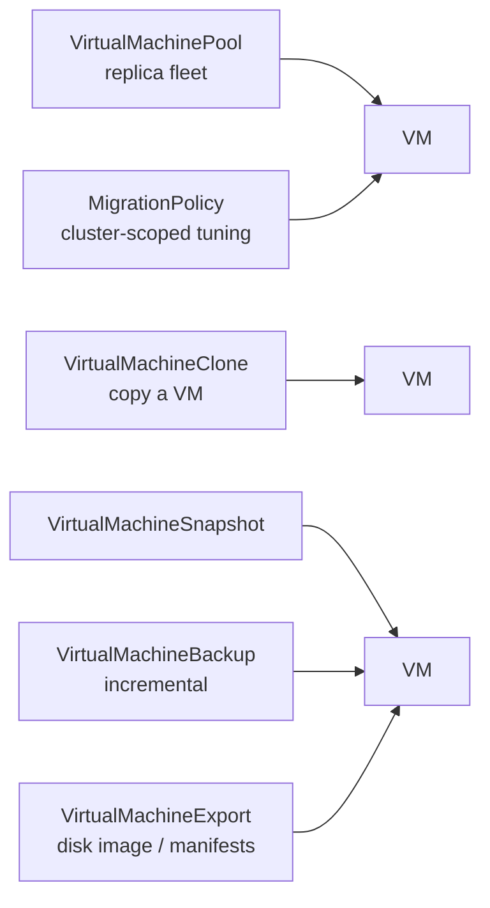

# Other VM lifecycle operators — API examples

Beyond `VirtualMachine`, several controllers manage VMs for you. Each is a
separate CRD with its own API group.



| Manifest | Kind | Group / Version | Tier |
| --- | --- | --- | --- |
| [`vm-pool.yaml`](vm-pool.yaml) | `VirtualMachinePool` | `pool.kubevirt.io/v1beta1` | 2 |
| [`vm-clone.yaml`](vm-clone.yaml) | `VirtualMachineClone` | `clone.kubevirt.io/v1beta1` | 2 |
| [`vm-snapshot-restore.yaml`](vm-snapshot-restore.yaml) | `VirtualMachineSnapshot`, `VirtualMachineRestore` | `snapshot.kubevirt.io/v1beta1` | 2 |
| [`vm-export.yaml`](vm-export.yaml) | `VirtualMachineExport` | `export.kubevirt.io/v1beta1` | 2 |
| [`vm-backup.yaml`](vm-backup.yaml) | `VirtualMachineBackup`, `VirtualMachineBackupTracker` | `backup.kubevirt.io/v1alpha1` | **4** |

```bash
NS=vms
SERVER=$(oc whoami --show-server)
```

---

## VirtualMachinePool

A replica-set for VMs: it owns N interchangeable VMs and reconciles toward
`replicas`, replacing failures and rolling out template changes.

```bash
envsubst < vm-pool.yaml | oc apply -f -
```

```bash
curl -s $CURL -X POST \
  -H 'Content-Type: application/yaml' \
  "$SERVER/apis/pool.kubevirt.io/v1beta1/namespaces/$NS/virtualmachinepools" \
  --data-binary @<(envsubst < vm-pool.yaml)
```

### Field reference

| Field | Meaning |
| --- | --- |
| `replicas` | Desired VM count (default 1) |
| `selector` | Label selector deciding which VMs the pool owns — **required** |
| `maxUnavailable` | Integer or percentage allowed down during an update (default 100%) |
| `paused` | Freeze the controller |
| `scaleInStrategy.opportunistic` | How VMs removed by other means are handled, incl. `statePreservation` |
| `updateStrategy.opportunistic` | Update the VM only; the VMI picks it up on next restart (gentler) |
| `updateStrategy.proactive` | Update VM **and** the running VMI immediately (forces restart/migration) |
| `autohealing.minFailingToStartDuration` | How long a VM may be failing before the pool replaces it |
| `nameGeneration.appendIndexToConfigMapRefs` / `…SecretRefs` | Index-suffix generated references |

The selector must match `spec.template.metadata.labels`, and the pool refuses to
adopt VMs it did not create.

### Scale

```bash
oc scale virtualmachinepool rhel9-fleet --replicas=5 -n $NS
```

```bash
curl -s $CURL -X PUT \
  -H 'Content-Type: application/json' \
  "$SERVER/apis/pool.kubevirt.io/v1beta1/namespaces/$NS/virtualmachinepools/rhel9-fleet/scale" \
  -d '{"apiVersion":"autoscaling/v1","kind":"Scale",
       "metadata":{"name":"rhel9-fleet","namespace":"'$NS'"},
       "spec":{"replicas":5}}'
```

### Inspect

```bash
oc get virtualmachinepool rhel9-fleet -n $NS -o jsonpath='{.status}' | python3 -m json.tool

curl -s $CURL "$SERVER/apis/pool.kubevirt.io/v1beta1/namespaces/$NS/virtualmachinepools/rhel9-fleet" \
  | python3 -c "
import json,sys
s=json.load(sys.stdin)['status']
print('replicas        :', s.get('replicas'))
print('readyReplicas   :', s.get('readyReplicas'))
for c in s.get('conditions',[]): print(' ', c['type'], c['status'], c.get('message',''))
"
```

---

## VirtualMachineClone

Clones a VM **and its disks**, regenerating network and SMBIOS identities so the
copy does not collide with the original.

```bash
oc get vmclone -n $NS
oc get vmclone clone-of-source-vm -n $NS -o jsonpath='{.status.phase}{"\n"}'
```

```bash
curl -s $CURL "$SERVER/apis/clone.kubevirt.io/v1beta1/namespaces/$NS/virtualmachineclones" \
  | python3 -c "import json,sys; [print(i['metadata']['name'], i['status'].get('phase')) for i in json.load(sys.stdin)['items']]"
```

Phases: `SnapshotInProgress` → `CreatingTargetVM` → `CloneVolumesInProgress` →
`RestoreInProgress` → `Succeeded` / `Failed`.

The controller snapshots the source first, so cloning a **running** VM is
supported and consistent.

| Field | Purpose |
| --- | --- |
| `source` / `target` | Typed local object references |
| `newVolumeNames` | Clone only these volumes; others are dropped from the target |
| `labelFilters` / `annotationFilters` | `"*"` copy all, `"!pattern"` exclude |
| `newMacAddresses` | `{interfaceName: mac}` overrides |
| `newSMBiosSerial` | Override the generated serial |
| `patches` | JSON patches applied to the target VM |

> **Validated on OCP 4.22 — two limitations:**
>
> 1. **Same namespace only.** The source and target VMs must be in the same
>    namespace as the `VirtualMachineClone` object. A cross-namespace reference
>    fails with `Source doesnt exist: VirtualMachine <ns>/<name>` because the
>    controller resolves the source relative to the clone's own namespace.
>
> 2. **Requires working VolumeSnapshots.** The clone flow snapshots the source
>    PVCs first. If the snapshot never reaches `readyToUse`, the clone fails after
>    the deadline with `snapshot deadline exceeded`. There are two common causes,
>    both covered under [Snapshots and restore](#snapshots-and-restore) below:
>    duplicate snapshot controllers, and the fact that NFS-CSI snapshots are full
>    volume copies capped at a 20-minute timeout — which large VM disks never
>    finish. Note that a *snapshot test on a small PVC can pass* while cloning a
>    real VM disk still fails.


---

## Snapshots and restore

```bash
oc apply -f - <<YAML
apiVersion: snapshot.kubevirt.io/v1beta1
kind: VirtualMachineSnapshot
metadata:
  name: web-01-snap
  namespace: ${NS}
spec:
  failureDeadline: 10m
  source:
    apiGroup: kubevirt.io
    kind: VirtualMachine
    name: web-01
YAML

oc wait --for=jsonpath='{.status.phase}'=Succeeded vmsnapshot/web-01-snap -n $NS --timeout=30m
```

```bash
curl -s $CURL -X POST \
  -H 'Content-Type: application/json' \
  "$SERVER/apis/snapshot.kubevirt.io/v1beta1/namespaces/$NS/virtualmachinesnapshots" \
  -d "{\"apiVersion\":\"snapshot.kubevirt.io/v1beta1\",\"kind\":\"VirtualMachineSnapshot\",
       \"metadata\":{\"name\":\"web-01-snap\",\"namespace\":\"$NS\"},
       \"spec\":{\"failureDeadline\":\"10m\",
                 \"source\":{\"apiGroup\":\"kubevirt.io\",\"kind\":\"VirtualMachine\",\"name\":\"web-01\"}}}"
```

Restore recreates the VM **and** its disks:

```bash
oc apply -f - <<YAML
apiVersion: snapshot.kubevirt.io/v1beta1
kind: VirtualMachineRestore
metadata:
  name: web-01-restore
  namespace: ${NS}
spec:
  target:
    apiGroup: kubevirt.io
    kind: VirtualMachine
    name: web-01
  virtualMachineSnapshotName: web-01-snap
YAML
```

### Prerequisite

Snapshots need a `snapshotClass` in the `StorageProfile`:

```bash
oc get storageprofile -o custom-columns=\
NAME:.metadata.name,CLONE:.status.cloneStrategy,SNAPCLASS:.status.snapshotClass
```

```bash
curl -s $CURL "$SERVER/apis/cdi.kubevirt.io/v1beta1/storageprofiles" \
  | python3 -c "
import json,sys
for s in json.load(sys.stdin)['items']:
    st=s.get('status',{})
    print(f\"{s['metadata']['name']:22} clone={st.get('cloneStrategy','-'):10} snapclass={st.get('snapshotClass','-')}\")
"
```

> **NFS CSI caveats (validated on OCP 4.22).** Two independent problems can make
> snapshots fail on an NFS-backed storage class. The `StorageProfile` is usually
> *not* at fault — check it, but expect it to be correct.
>
> **1. Duplicate snapshot controllers.** OpenShift already runs a cluster-wide
> `snapshot-controller` in `openshift-cluster-storage-operator`. The
> `csi-driver-nfs` Helm chart can optionally deploy a **second** one in its own
> namespace. Both elect a leader using a Lease named `snapshot-controller-leader`,
> but leases are namespaced, so neither sees the other and **both act as
> leader**. They then race on the same `VolumeSnapshot`/PVC objects:
>
> ```
> Operation cannot be fulfilled on persistentvolumeclaims "…": the object has been modified
> Operation cannot be fulfilled on volumesnapshots…: the object has been modified
> ```
>
> The snapshot never stabilises, so it fails after the deadline with
> `snapshot deadline exceeded`. Diagnose and fix:
> ```bash
> # both leases exist, in different namespaces, each with a live holder?
> oc get lease -A | grep snapshot-controller-leader
>
> # disable the chart's duplicate (permanent fix: externalSnapshotter.enabled=false)
> oc scale deploy snapshot-controller -n csi-driver-nfs --replicas=0
> ```
> Disabling it does **not** remove the driver's `csi-snapshotter` sidecar — that
> is gated separately by `controller.enableSnapshotter`.
>
> **2. Snapshots are full copies, with a 20-minute deadline.** The NFS CSI driver
> does not do copy-on-write; it tars the whole volume
> (`controllerserver.go: tar /tmp/pvc-… -> …tar.gz`). The sidecar's
> `--timeout=1200s` caps each attempt at 20 minutes, and a retry re-copies from
> scratch. A 1Gi volume snapshots in seconds; a 106Gi VM disk cannot finish in
> time and fails with `DeadlineExceeded`. Compression is on by default, which
> makes it slower still.
>
> So NFS-CSI snapshots are workable for small volumes and **not** suitable for
> large VM disks — regardless of the controller fix. For VM-level backups on NFS,
> export the disk, or use storage with real snapshot support.
>
> Quick smoke test before relying on snapshots:
> ```bash
> oc apply -f - <<'YAML'
> apiVersion: v1
> kind: PersistentVolumeClaim
> metadata: {name: snap-test, namespace: $NS}
> spec:
>   accessModes: [ReadWriteMany]
>   storageClassName: nfs-csi
>   resources: {requests: {storage: 1Gi}}
> YAML
> oc apply -f - <<YAML
> apiVersion: snapshot.storage.k8s.io/v1
> kind: VolumeSnapshot
> metadata: {name: snap-test-snap, namespace: $NS}
> spec:
>   volumeSnapshotClassName: csi-nfs-snapclass
>   source: {persistentVolumeClaimName: snap-test}
> YAML
> oc get volumesnapshot snap-test-snap -n $NS -o jsonpath='{.status.readyToUse}{"\n"}'
> # "true" within seconds = working. Still false after 5 min = see (1) above.
> ```


### Lifecycle independence

- Deleting a `VirtualMachineSnapshot` does **not** delete the VM.
- Deleting the VM does **not** delete the snapshot.

That is what makes snapshots the right safety net before a deletion — see
[`04-delete/`](../04-delete/).

Related objects: `VirtualMachineSnapshotContent` (the actual PVC references) and
`VirtualMachineRestore`.

---

## Export

Turn a VM, snapshot or PVC into a downloadable disk image plus a manifest.

```bash
oc apply -f vm-export.yaml
oc get vmexport -n $NS
```

```bash
curl -s $CURL "$SERVER/apis/export.kubevirt.io/v1beta1/namespaces/$NS/virtualmachineexports/web-01-export" \
  | python3 -c "
import json,sys
d=json.load(sys.stdin)
st=d.get('status',{})
print('phase:', st.get('phase'))
print('internal links:')
for l in st.get('links',{}).get('internal',{}).get('volumes',[]) or []:
    for f in l.get('formats',[]):
        print('  ', l['name'], f['format'], f['url'])
"
```

With `virtctl`:

```bash
virtctl vmexport create web-01-export --vm=web-01 -n $NS --ttl=2h
virtctl vmexport download web-01-export --output=disk.img.gz -n $NS
virtctl vmexport download web-01-export --manifest -n $NS
virtctl vmexport delete web-01-export -n $NS
```

| Field | Meaning |
| --- | --- |
| `source` | `VirtualMachine`, `VirtualMachineSnapshot` or `PersistentVolumeClaim` — **required** |
| `ttlDuration` | Auto-delete after this (default 2h) |
| `tokenSecretRef` | Custom auth token for the export server |

`status.links.internal` works inside the cluster; `status.links.external`
requires a Route and the CA cert from `status.links.external.cert`.

Exports whose source is a bare `PersistentVolumeClaim` do **not** generate a
`VirtualMachine` manifest — only `VirtualMachine` and `VirtualMachineSnapshot`
sources do.

### Extracting an external export

```bash
oc get vmexport web-01-export -n $NS -o jsonpath='{.status.links.external.cert}' > cacert.crt
curl -s --cacert cacert.crt \
  "$(oc get vmexport web-01-export -n $NS -o jsonpath='{.status.links.external.volumes[0].formats[?(@.format=="raw")].url}')" \
  -o disk.img
```

---

## Backup (tier 4)

Incremental, checkpoint-based backup. The tracker remembers the last pushed state
so subsequent backups carry only changed blocks.

> **Tier 4.** No compatibility guarantee. Validate against your storage backend
> before production use. For stable backups prefer `VirtualMachineSnapshot`.

```bash
oc apply -f vm-backup.yaml
oc get vmbackup,vmbackuptracker -n $NS
```

| Field | Meaning |
| --- | --- |
| `source` | A `VirtualMachine` or a `VirtualMachineBackupTracker` — **required** |
| `mode` | `Push` or `Pull` |
| `pvcName` | Target PVC — required in `Push` mode |
| `forceFullBackup` | Ignore checkpoints, send everything |
| `skipQuiesce` | Skip guest filesystem quiescing (needs the QEMU guest agent) |
| `tokenSecretRef` | Auth secret for `Pull` mode |
| `ttlDuration` | Auto-delete a `Pull` backup and its export |

---

## MigrationPolicy (tier 4)

Cluster-scoped tuning for live migration: bandwidth, concurrency, timeouts, and
which VMs a policy matches.

```bash
oc get migrationpolicies
oc explain migrationpolicy.spec
```

```bash
curl -s $CURL "$SERVER/apis/migrations.kubevirt.io/v1alpha1/migrationpolicies" | python3 -m json.tool
```

Use it to stop a bulk migration storm from squeezing latency-sensitive VMs, or to
relax timeouts for very large guests.

---

## Inspect everything at once

```bash
for r in virtualmachinepools vmclones vmsnapshots vmsnapshotcontents vmrestores \
         vmbackups vmbackuptrackers vmexports migrationpolicies; do
  printf '\n=== %s ===\n' "$r"
  oc get "$r" -A 2>/dev/null || echo "  (not available)"
done
```

```bash
for g in pool.kubevirt.io/clone.kubevirt.io/snapshot.kubevirt.io/export.kubevirt.io/backup.kubevirt.io/migrations.kubevirt.io; do
  grp="${g%%/*}"; ver="${g##*/}"
  printf '\n=== %s ===\n' "$grp"
  curl -s $CURL "$SERVER/apis/$grp" | python3 -c "import json,sys; print('\n'.join(v['version'] for g in json.load(sys.stdin)['groups'] for v in g['versions']))" 2>/dev/null || echo "  (not served)"
done
```
