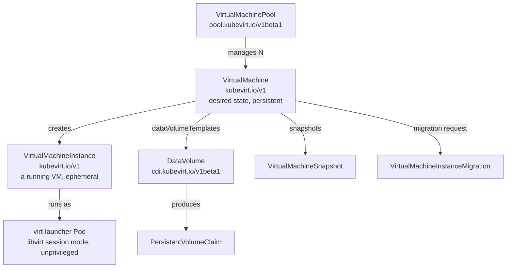

# API surface

All VM objects live in the `kubevirt.io` API group. Read the schema directly
from the API server rather than trusting a doc version.

```bash
oc api-resources --api-group=kubevirt.io
oc explain virtualmachine
oc explain virtualmachine.spec --recursive
oc get --raw /openapi/v3/kubevirt.io | python3 -m json.tool | head
```

## The object model



- **`VirtualMachine`** — the durable definition. Scale it, snapshot it, edit it.
- **`VirtualMachineInstance`** — a *running* VM. Created and destroyed by the VM
  controller. Never edit this directly; edit the `VirtualMachine`.
- **`virt-launcher` Pod** — one pod per running VMI, running `libvirt` in session
  mode as a non-root user. VMs are unprivileged workloads.

## Objects you will actually use

| Kind | Group / Version | Purpose |
| --- | --- | --- |
| `VirtualMachine` | `kubevirt.io/v1` | Define, start, stop, edit VMs |
| `VirtualMachineInstance` | `kubevirt.io/v1` | Observe a running VM |
| `VirtualMachineInstanceMigration` | `kubevirt.io/v1` | Live migrate a running VM |
| `VirtualMachineSnapshot` / `VirtualMachineRestore` | `snapshot.kubevirt.io/v1beta1` | Point-in-time snapshots |
| `VirtualMachineClone` | `clone.kubevirt.io/v1beta1` | Clone a VM (incl. cross-namespace) |
| `VirtualMachineExport` | `export.kubevirt.io/v1beta1` | Export disks / manifests |
| `VirtualMachinePool` | `pool.kubevirt.io/v1beta1` | ReplicaSet-style VM fleet |
| `VirtualMachineInstancetype` (namespaced / cluster) | `instancetype.kubevirt.io/v1beta1` | Reusable vCPU + RAM shapes |
| `VirtualMachinePreference` (namespaced / cluster) | `instancetype.kubevirt.io/v1beta1` | OS-specific device/feature tuning |
| `DataVolume`, `DataSource`, `DataImportCron` | `cdi.kubevirt.io/v1beta1` | Import, clone, register disk images |
| `MigrationPolicy` | `migrations.kubevirt.io/v1alpha1` | Cluster-scoped migration tuning |

## Two ways to specify hardware

**Explicit** — set the fields yourself:

```yaml
spec:
  template:
    spec:
      domain:
        cpu:    {cores: 4, sockets: 1, threads: 1}
        memory: {guest: 16Gi}
```

**Instancetype** — reference a reusable shape (preferred):

```yaml
spec:
  instancetype:
    kind: VirtualMachineClusterInstancetype
    name: u1.large
  preference:
    kind: VirtualMachineClusterPreference
    name: rhel.9
```

```bash
oc get virtualmachineclusterinstancetypes
oc get virtualmachineclusterpreferences
oc describe virtualmachineclusterinstancetype u1.large
```

Instance types and preferences are *matchers*, not copies — the controller
resolves them at VM creation and records the result in `status.instancetypeRef`.

You can infer them from a boot source, which is what the console wizard does:

```yaml
  instancetype:
    inferFromVolume: my-root-disk
    inferFromVolumeFailurePolicy: Ignore
  preference:
    inferFromVolume: my-root-disk
    inferFromVolumeFailurePolicy: Ignore
```

The `DataSource` carries the defaults as labels:

```bash
oc get datasource rhel9 -n openshift-virtualization-os-images -o jsonpath='{.metadata.labels}' | tr ',' '\n'
# instancetype.kubevirt.io/default-instancetype: u1.medium
# instancetype.kubevirt.io/default-preference:   rhel.9
```

## Run strategy

`spec.runStrategy` controls whether a VMI should exist:

| Value | Behaviour |
| --- | --- |
| `Always` | VMI always running. Restarts on failure. |
| `Halted` | VMI never running. |
| `Manual` | API-controlled — use `spec.running` or `virtctl start/stop`. |
| `RerunOnFailure` | Start, restart on failure, stop on clean exit. |
| `Once` | Run once, never restart. |

`runStrategy` and `spec.running` are mutually exclusive.

## Handy field paths

```bash
oc explain virtualmachine.spec.runStrategy
oc explain virtualmachine.spec.dataVolumeTemplates
oc explain virtualmachine.spec.template.spec.domain.cpu
oc explain virtualmachine.spec.template.spec.domain.memory
oc explain virtualmachine.spec.template.spec.domain.devices.interfaces
oc explain virtualmachine.spec.template.spec.networks
oc explain virtualmachine.spec.template.spec.affinity
```
