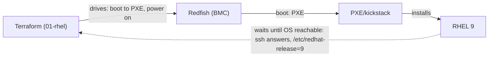

# 01 — Install RHEL on a bare-metal server

Provision a raw server to a running **RHEL 9**: point its next boot at the
network (PXE), power it on, and wait until the OS is reachable.

## The boundary

Terraform **drives** the BMC (the `dell/redfish` provider sets the boot source to
PXE and powers the server on) and **waits** for the result (`null_resource` polls
for a reachable RHEL 9). It does **not** install RHEL — the install is performed
by your PXE/kickstart stack, which is external to Terraform. There is no
first-class Terraform "install an OS" resource; the kickstart is a build/infrastructure
concern that lives in your provisioning pipeline.

This is the one layer that runs *before* there is a cluster. Once the server is
a RHEL 9 host, it is registered with OpenShift as a node (layer 2/3 in
[`02-cluster/`](../02-cluster/)).

## Provider

`dell/redfish` — the only provider that reaches hardware. Two resources per
server:

- `redfish_boot_source_override` — set next-boot to `Pxe` (UEFI mode), then a
  reset so the server PXE-boots.
- `redfish_power` — `ForceOn` so the override takes effect.

Credentials are supplied per-resource via the nested `redfish_server {}` block
(endpoint, user, password, ssl_insecure), so the module stays self-contained
across any number of servers.

## The wait

The `null_resource` retries `ssh root@<os_ip>` up to 120 times (30s apart) and
succeeds once `/etc/redhat-release` reports major version 9. Replace the probe
with whatever your environment uses (a kickstart completion hook, Ansible
reachable, cloud-init status) — the point is to gate the next layer on "the OS
is up," not to prescribe a check.

## Validation

`terraform init` + `terraform validate` pass against the provider schemas with
no cluster and no BMC. A real `terraform apply` needs reachable BMC endpoints and
a working PXE stack.

## Related

- [`02-cluster/`](../02-cluster/) — what happens to the node once RHEL is up
- [`../docs/00-prerequisites.md`](../docs/00-prerequisites.md)
